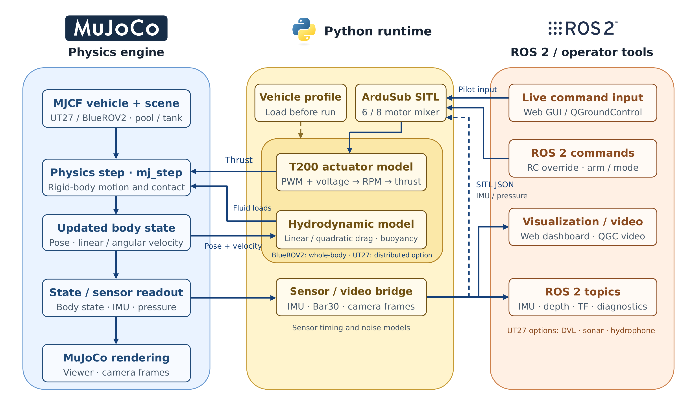
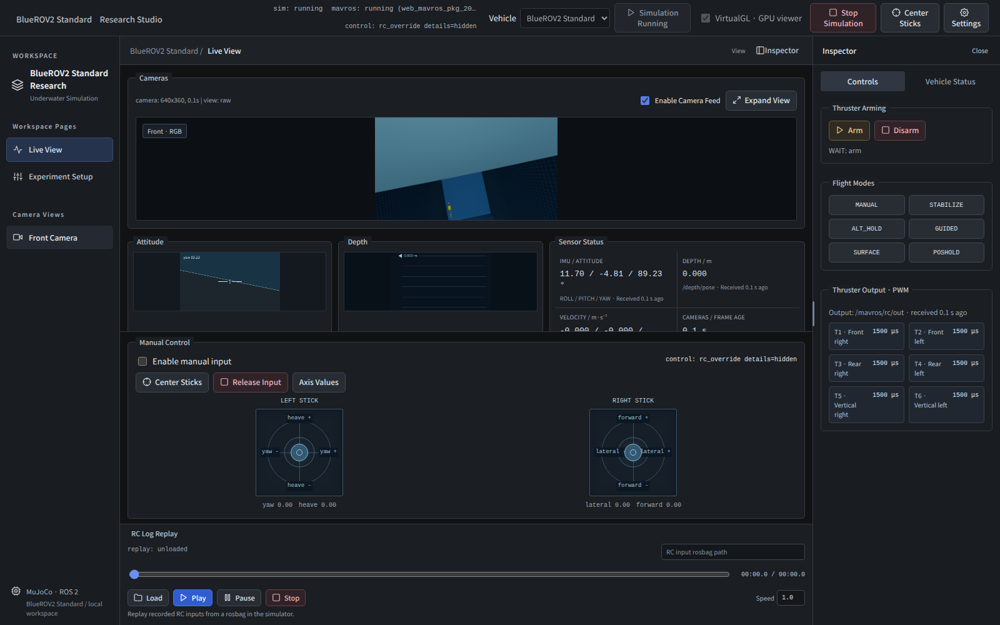
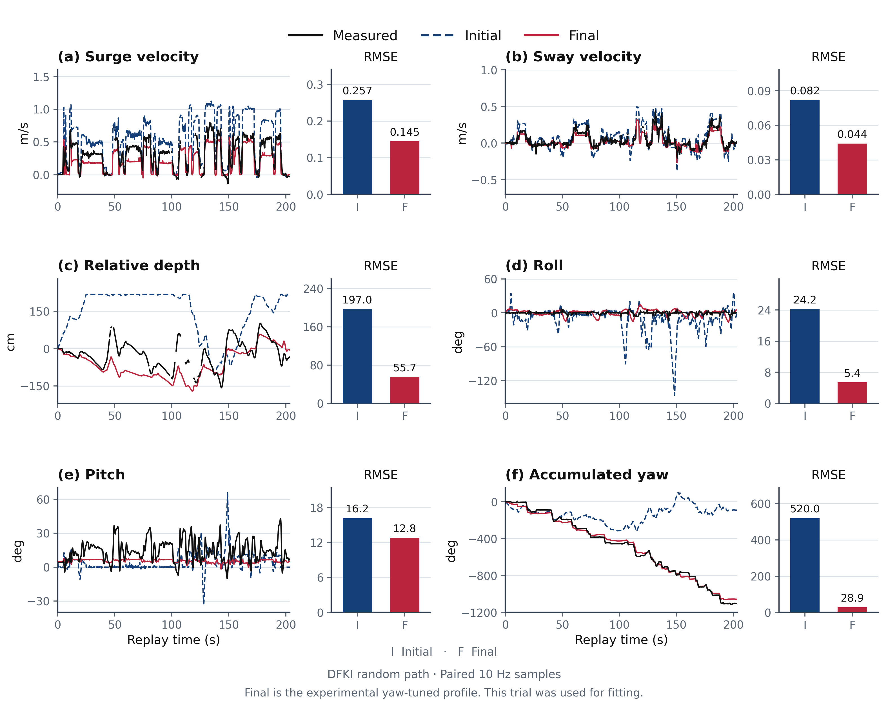
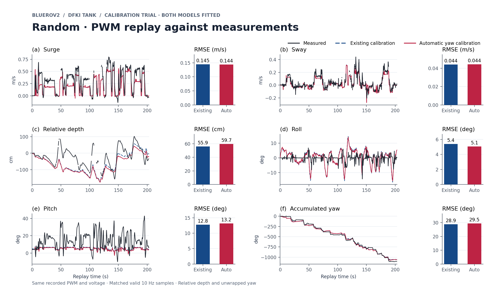
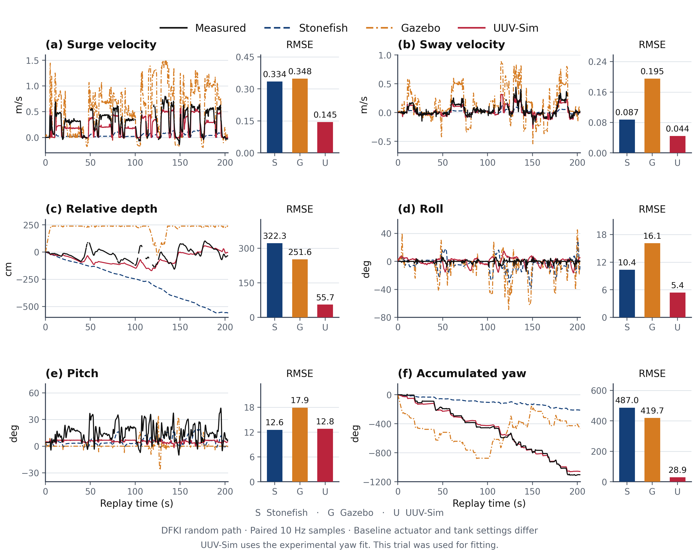
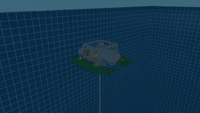
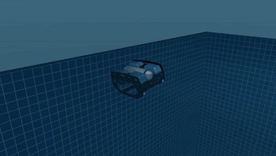

# UUV-Sim · MuJoCo Underwater Robotics Simulator

[한국어](README.md) · **English**

A MuJoCo-based underwater robotics simulator. Select and pilot the UT27 research-pool vehicle or a six-thruster BlueROV2 Standard model, with ArduSub SITL, sensor and camera output, ROS 2 integration, and recorded-command replay workflows.

<div align="center">

<a href="docs/contracts/REAL2SIM_QUICKSTART.md"></a>

**Vehicle information · sensor setup · measured log formats · execution**

[Open the calibration guide](docs/contracts/REAL2SIM_QUICKSTART.md)　|　[Six-metric comparison](#automatic-calibration-results)　|　[Workflow PowerPoint](docs/paper/real2sim-automation-workflow.pptx)

</div>



## Quick start

The supported setup target is Ubuntu 22.04 / ROS 2 Humble / Linux x86_64. Clone with Git LFS and the ArduPilot submodule, then follow the [Docker setup guide](docker/ubuntu-dev/README.md) to build and install the container. Build SITL and the ROS workspace using the same guide, then start the web GUI. Open the Docker web GUI at [http://127.0.0.1:8878/](http://127.0.0.1:8878/). See [README_FIRST.md](README_FIRST.md) for prerequisites and distribution notes.

```bash
./docker/ubuntu-dev/dev.sh build
./docker/ubuntu-dev/dev.sh install
./docker/ubuntu-dev/dev.sh build-sitl
./docker/ubuntu-dev/dev.sh build-ros
./docker/ubuntu-dev/dev.sh web
```
Choose **BlueROV2 Standard** or **UT27** from **Vehicle**, then select **Start Simulation**. Change the display language under **Settings → General → Language**.



To replay the DFKI random-path pilot inputs through SITL, open `/workspace/docs/paper/data/dfki-random-rcin-bag` in **RC Log Replay** in Docker. [Replay data and conditions](docs/paper/README.md#reproduce-or-replay)

Build a calibrated MuJoCo vehicle from a model, sensor mounts, and recorded motor outputs. Completed models appear in the web GUI’s **Vehicle** menu. [Input contract and BlueROV2 reproduction](docs/contracts/REAL2SIM_AUTOMATION.md)

## System architecture

| Layer | Responsibility |
| --- | --- |
| MuJoCo plant | Rigid-body integration and contact resolution |
| Python physics/runtime | Loads models, scenes and profiles; calculates buoyancy, drag, and propulsion; produces sensor state and manages the viewer |
| ArduSub SITL | Receives IMU/depth inputs, runs controller and mixer, outputs servo PWM |
| Bridges | Connect SITL JSON/MAVLink, ROS 2 sensor/camera topics, and external commands |
| GUI | Selects vehicle, scene and profile; controls lifecycle and piloting; displays cameras and sensors |

The closed loop is `MuJoCo state → sensors/SITL → ArduSub PWM → thrust and hydrodynamics → next MuJoCo state`. See the [architecture guide](docs/SIM_ARCHITECTURE.md) for runtime paths and ports. The [BlueROV2 model note](docs/contracts/BLUEROV2_MODEL.md) records CAD geometry, frame conventions, sensor placements and T200 assumptions. The [contact note](docs/contracts/BLUEROV2_CONTACT.md) lists contact-material and coefficient assumptions.

## BlueROV2 model and replay scope

The vehicle geometry converts public BlueROV2 ROS 2 Xacro/CAD meshes into MuJoCo OBJ assets and applies public thruster mounting locations and T200 performance data. Some mass distribution, center of buoyancy, added mass, friction, and damping values are starting assumptions because public sources do not specify them. The public DFKI dataset supplies experimental context and RC/PWM and state logs; those records alone do not establish every physical parameter of the tested vehicle.

Figure 01 compares the initial and yaw-tuned profiles on the DFKI random-path trial used for fitting. The yaw-tuned profile is the current BlueROV2 GUI default. Its pooled accumulated yaw error increased on fitting-excluded runs. The offline comparison replays recorded PWM at its original timestamps and computes RMSE over valid paired samples. See the [model and replay procedure](docs/contracts/BLUEROV2_MODEL.md) for preparation and scoring, and the [figure index](docs/paper/README.md) for the trial split and evaluation scope.



## Automatic calibration results

Measured data (black), existing calibration (blue), and automatic yaw calibration (red) are compared using the same recorded PWM and voltage from the DFKI random-path trial. **Both models were fitted on this trial.** Accumulated yaw RMSE is **28.91°** for the existing calibration and **29.47°** for automatic calibration on the same 2,036 valid yaw samples. [Separate holdout results](docs/contracts/REAL2SIM_QUICKSTART.md#bluerov2에서-재현)



[Required inputs and execution](docs/contracts/REAL2SIM_QUICKSTART.md) · [Editable calibration workflow PPT](docs/paper/real2sim-automation-workflow.pptx)

## Simulator comparison

| Item | UUV-Sim (MuJoCo) | Stonefish public BlueROV2 model | Gazebo public BlueROV2 model |
| --- | --- | --- | --- |
| Purpose | Run this repository's ROV/SITL/sensor integration and replay measured logs | Replay a public Stonefish ROS 2 scenario | Replay a public Gazebo Harmonic BlueROV2 SDF model |
| Compared model | BlueROV2 Standard CAD-converted model in this repository | Public six-thruster `bluerov_fls.scn` scenario | Public `bluerov2_gz` SDF model |
| SITL / ROS 2 | Platform includes ArduSub SITL and sensor bridge; this comparison replay uses logged PWM in a physics-only path | Public ROS 2 scenario; this comparison replay uses physics only | Public Gazebo model; this comparison replay uses physics only |
| Hydrodynamic coefficients | UUV-Sim profile fitted to the DFKI trial | Public model coefficients | Public model coefficients |
| Physics / fluid update | 1 ms integration, Python fluid and propulsion forces each step | 5 ms physics, 50 Hz hull-fluid update | 5 ms physics and public-model hydrodynamics update |
| PWM conversion | T200 PWM-to-RPM-to-thrust tables using recorded voltage | `(PWM − 1500)/400` normalized command | `(PWM − 1500)/8` N |
| Interpretation | Replay result with a disclosed fitted profile and measurement scope | Replay result under its own public model and PWM conversion | Replay result under its own public model and PWM conversion |

Figure 02 shows **offline physics-only replays of the same public DFKI input record in each configuration**. The two baseline models retain their public hydrodynamic and actuator settings; UUV-Sim uses coefficients fitted to this random-path trial. The table summarizes update rates and command conversions. See the [figure index](docs/paper/README.md) and [BlueROV2 source register](uuv_mujoco/current/research_workspace/04_paper_evidence/REFERENCES_BLUEROV2.md) for full run conditions and pinned versions.



| Axis RMSE | Stonefish | Gazebo | UUV-Sim |
| --- | ---: | ---: | ---: |
| Surge (m/s) | 0.334 | 0.348 | 0.145 |
| Sway (m/s) | 0.087 | 0.195 | 0.044 |
| Relative depth (cm) | 322.3 | 251.6 | 55.7 |
| Roll (deg) | 10.36 | 16.13 | 5.40 |
| Pitch (deg) | 12.56 | 17.91 | 12.79 |
| Accumulated yaw (deg) | 487.0 | 419.7 | 28.9 |

UUV-Sim hydrodynamic coefficients were fitted using the random-path trial. Stonefish and Gazebo use the coefficients and actuator models from their respective public models. The table compares UUV-Sim on its fitting trial with replay results from the two public baseline models; it does not represent generalization to independent logs. See the full [PDF figure](docs/paper/figure-02-simulator-comparison.pdf).

## Simulator recordings

Both previews show the 14-second SITL driving demos. Select either preview to open its original MP4.

| UT27 | BlueROV2 Standard |
| --- | --- |
| [](docs/assets/ut27-sitl-demo.mp4) | [](docs/assets/bluerov2-sitl-demo.mp4) |

[UT27 preview GIF](docs/assets/simulator-demo.gif)

## Paper figures and references

- [Figure index and use notes](docs/paper/README.md): initial/final fit, Stonefish/Gazebo comparison, calibration workflow, framework
- [BlueROV2 source register](uuv_mujoco/current/research_workspace/04_paper_evidence/REFERENCES_BLUEROV2.md) · [BibTeX](uuv_mujoco/current/research_workspace/04_paper_evidence/references_bluerov2.bib)
- [Vehicle assets and licenses](uuv_mujoco/current/assets/bluerov2_standard/README.md)
- [DFKI v3 public dataset](https://zenodo.org/records/17360027) · [paper DOI](https://doi.org/10.1038/s41597-025-06347-0)

## UT27 research features

The [UT27 research update](docs/UUV_UPDATE_20260922.md) describes the VLA demonstration interface and its validation limits. The presence of a GUI or collection tool does not by itself establish learned-policy success or transfer to a physical vehicle.
