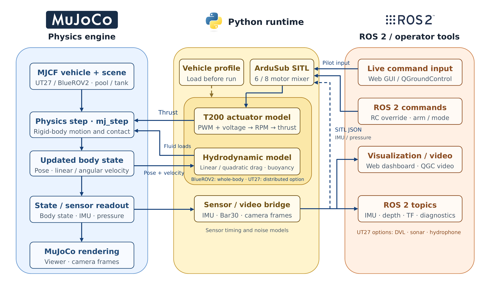
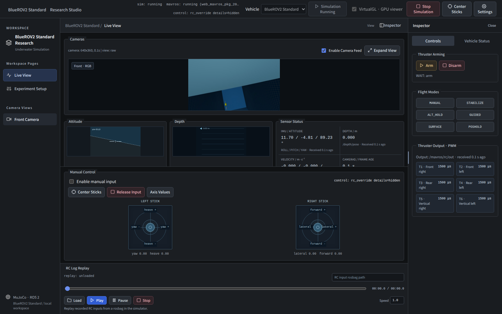
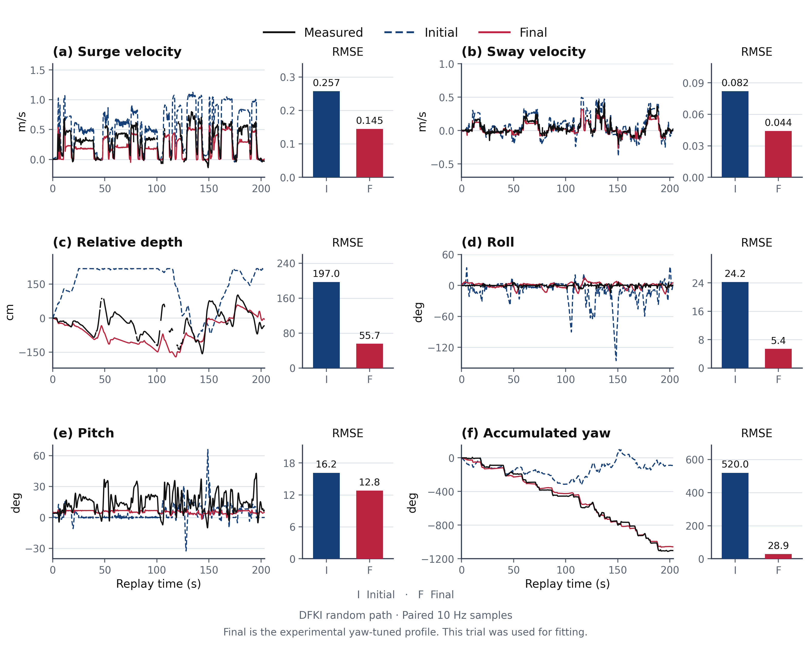
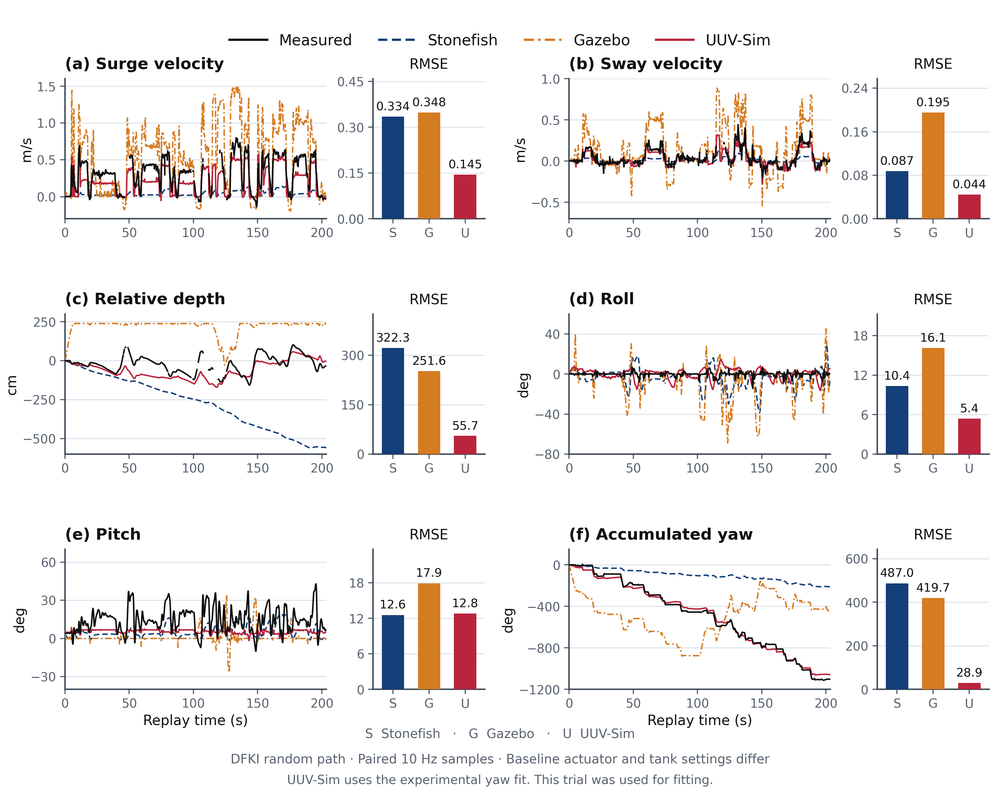
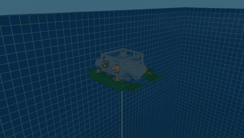
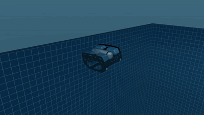

# UUV-Sim · MuJoCo 수중로봇 시뮬레이션

**한국어** · [English](README.en.md)

MuJoCo 기반 수중 로봇 시뮬레이터입니다. UT27 연구 수조 환경과 BlueROV2 Standard 6추진기 모델을 선택해 조종할 수 있으며, ArduSub SITL, 센서·카메라, ROS 2 연동 및 실측 명령 재생 경로를 제공합니다.



## 빠른 시작

설치 대상은 Ubuntu 22.04 / ROS 2 Humble / Linux x86_64입니다. Git LFS와 ArduPilot submodule을 포함해 저장소를 받은 뒤 [Docker 환경 설치 안내](docker/ubuntu-dev/README.md)의 순서대로 컨테이너를 빌드하고 설치합니다. 해당 안내에 따라 SITL과 ROS 워크스페이스도 빌드한 뒤 웹 GUI를 시작하세요. Docker 웹 GUI는 [http://127.0.0.1:8878/](http://127.0.0.1:8878/)에서 엽니다. 자세한 사전 조건과 배포판 주의사항은 [README_FIRST.md](README_FIRST.md)를 참고하세요.

```bash
./docker/ubuntu-dev/dev.sh build
./docker/ubuntu-dev/dev.sh install
./docker/ubuntu-dev/dev.sh build-sitl
./docker/ubuntu-dev/dev.sh build-ros
./docker/ubuntu-dev/dev.sh web
```

상단 **Vehicle**에서 **BlueROV2 Standard** 또는 **UT27**을 고른 뒤 **Start Simulation**을 누릅니다. 언어는 **Settings → General → Language**에서 바꿀 수 있습니다.



Docker의 **RC Log Replay**에서 `/workspace/docs/paper/data/dfki-random-rcin-bag`를 열면 DFKI 무작위 주행의 조종 입력을 SITL에 재생할 수 있습니다. [재생 데이터와 사용 조건](docs/paper/README.md#reproduce-or-replay)

## 시스템 구성

| 계층 | 역할 |
| --- | --- |
| MuJoCo plant | 강체 운동 적분과 접촉 해석 |
| Python 물리·런타임 | 모델·장면·프로필 로드, 부력·항력·추진력 계산, 센서 상태 생성 및 뷰어 관리 |
| ArduSub SITL | IMU·수심 등 입력을 받아 제어기와 믹서 실행, 서보 PWM 출력 |
| 통신·센서 브리지 | SITL JSON/MAVLink, ROS 2 센서·카메라 토픽 및 외부 명령 연결 |
| GUI | 기체·장면·프로필 선택, 시뮬레이션 수명주기, 조종, 카메라와 센서 모니터링 |

폐루프는 `MuJoCo 상태 → 센서/SITL → ArduSub PWM → 추력·유체력 → 다음 MuJoCo 상태`로 진행합니다. 기본 구현 경로와 포트 계약은 [아키텍처 문서](docs/SIM_ARCHITECTURE.md)에 있습니다. BlueROV2 CAD 메시·좌표계·센서 가정·T200 모델은 [기체 모델 노트](docs/contracts/BLUEROV2_MODEL.md), 접촉 재질과 계수 가정은 [접촉 설정 노트](docs/contracts/BLUEROV2_CONTACT.md)에 기록했습니다.

## BlueROV2 모델 및 재현 범위

기체 형상은 공개 BlueROV2 ROS 2 Xacro/CAD 메시를 MuJoCo OBJ 자산으로 변환하고, 공개 장착 위치와 T200 특성표를 적용했습니다. 공개 자료가 정하지 않는 질량 분포, 부력중심, 추가질량, 마찰·감쇠 일부는 초기 가정입니다. DFKI 공개 데이터는 실험 맥락과 RC/PWM·상태 로그를 제공하지만, 그 기록만으로 시험 기체의 모든 물리 파라미터를 확정할 수 없습니다.

그림 01은 계수 적합에 사용된 DFKI 무작위 경로에서 실측과 최초·yaw 적합 결과를 비교합니다. yaw 실험 프로필은 현재 GUI 기본값이며, 적합 제외 로그에서는 누적 yaw 오차가 증가했습니다. 기록된 PWM을 원래 타임스탬프에 맞춰 재생하고 유효한 대응 샘플의 RMSE를 계산합니다. 적합 구간과 별도 시험 구간은 그림 설명에서 구분합니다. 데이터 준비·재생·채점 명령은 [모델 및 재현 절차](docs/contracts/BLUEROV2_MODEL.md)와 [DFKI 자료 레지스터](uuv_mujoco/current/research_workspace/04_paper_evidence/REFERENCES_BLUEROV2.md)에 있습니다. 논문용 그림 및 그 범위는 [그림 색인](docs/paper/README.md)을 참고하세요.



## 다른 시뮬레이터와의 비교

| 항목 | UUV-Sim (MuJoCo) | Stonefish 공개 BlueROV2 모델 | Gazebo 공개 BlueROV2 모델 |
| --- | --- | --- | --- |
| 목적 | 이 저장소의 ROV·SITL·센서 통합 실행 및 실측 로그 재생 | 공개 Stonefish ROS 2 시나리오 재생 기준 | 공개 Gazebo Harmonic BlueROV2 SDF 재생 기준 |
| 비교 모델 | 이 저장소 BlueROV2 Standard CAD 변환 모델 | 공개 6추진기 `bluerov_fls.scn` 시나리오 | 공개 `bluerov2_gz` SDF 모델 |
| SITL·ROS 2 | 플랫폼에 ArduSub SITL·센서 브리지 포함. 이 비교 재생은 기록 PWM을 넣은 physics-only 경로 | 공개 ROS 2 시나리오. 이 비교 재생은 physics-only 경로 | 공개 Gazebo 모델. 이 비교 재생은 physics-only 경로 |
| 유체력 계수 | DFKI 경로에 맞춰 적합한 UUV-Sim 프로필 | 공개 모델 계수 | 공개 모델 계수 |
| 물리/유체 업데이트 | 1 ms 적분, 매 스텝 Python 유체력·추진력 | 5 ms 물리, 50 Hz 선체 유체력 업데이트 | 5 ms 물리·공개 모델 유체력 업데이트 |
| PWM 변환 | 기록 전압 기반 T200 PWM→RPM→추력 표 | `(PWM − 1500)/400` 명령 정규화 | `(PWM − 1500)/8` N |
| 비교 해석 | 보정 프로필과 로그 범위를 명시한 실측 재현 결과 | 자체 공개 모델·PWM 변환 설정의 재현 결과 | 자체 공개 모델·PWM 변환 설정의 재현 결과 |

그림 02는 **동일한 공개 DFKI 입력 기록을 각 구성에 넣은 physics-only 오프라인 재생**입니다. 두 기준 모델은 공개 유체력·액추에이터 설정을 유지하고, UUV-Sim은 해당 무작위 경로에 적합한 계수를 사용합니다. 아래 표가 실행 주기와 명령 변환을 요약합니다. 전체 실행 조건과 고정 버전은 [그림 자료 색인](docs/paper/README.md) 및 [BlueROV2 출처 레지스터](uuv_mujoco/current/research_workspace/04_paper_evidence/REFERENCES_BLUEROV2.md)에 있습니다.



| 축별 RMSE | Stonefish | Gazebo | UUV-Sim |
| --- | ---: | ---: | ---: |
| Surge (m/s) | 0.334 | 0.348 | 0.145 |
| Sway (m/s) | 0.087 | 0.195 | 0.044 |
| Relative depth (cm) | 322.3 | 251.6 | 55.7 |
| Roll (deg) | 10.36 | 16.13 | 5.40 |
| Pitch (deg) | 12.56 | 17.91 | 12.79 |
| Accumulated yaw (deg) | 487.0 | 419.7 | 28.9 |

UUV-Sim은 평가에 사용한 무작위 경로로 유체력 계수를 적합했습니다. Stonefish와 Gazebo에는 각 공개 모델의 유체력·액추에이터 계수를 사용했습니다. 따라서 표는 UUV-Sim의 적합 구간 성능과 두 공개 기준 모델의 해당 입력 재현 결과를 비교하며, 독립 로그 일반화 성능을 나타내지 않습니다. 전체 그래프는 [PDF](docs/paper/figure-02-simulator-comparison.pdf)로 확인할 수 있습니다.

## 시뮬레이터 녹화

실행 화면 기록:

| UT27 | BlueROV2 Standard |
| --- | --- |
| [](docs/assets/ut27-sitl-demo.mp4) | [](docs/assets/bluerov2-sitl-demo.mp4) |

[UT27 미리보기 GIF](docs/assets/simulator-demo.gif)

## 논문 그림과 참고자료

- [그림 색인 및 사용 조건](docs/paper/README.md): 최초/최종 보정 결과, Stonefish·Gazebo 비교, 보정 흐름, 프레임워크
- [BlueROV2 출처 레지스터](uuv_mujoco/current/research_workspace/04_paper_evidence/REFERENCES_BLUEROV2.md) · [BibTeX](uuv_mujoco/current/research_workspace/04_paper_evidence/references_bluerov2.bib)
- [기체 자산과 라이선스](uuv_mujoco/current/assets/bluerov2_standard/README.md)
- [DFKI v3 공개 데이터](https://zenodo.org/records/17360027) · [논문 DOI](https://doi.org/10.1038/s41597-025-06347-0)

## UT27 연구 기능

VLA 시연 수집 인터페이스의 검증 현황과 제한 사항은 [UT27 연구 기록](docs/UUV_UPDATE_20260922.md)에 있습니다. 이 저장소의 GUI·수집 도구가 있다는 사실만으로 학습된 정책의 성공이나 실물 전이를 입증하지 않습니다.
