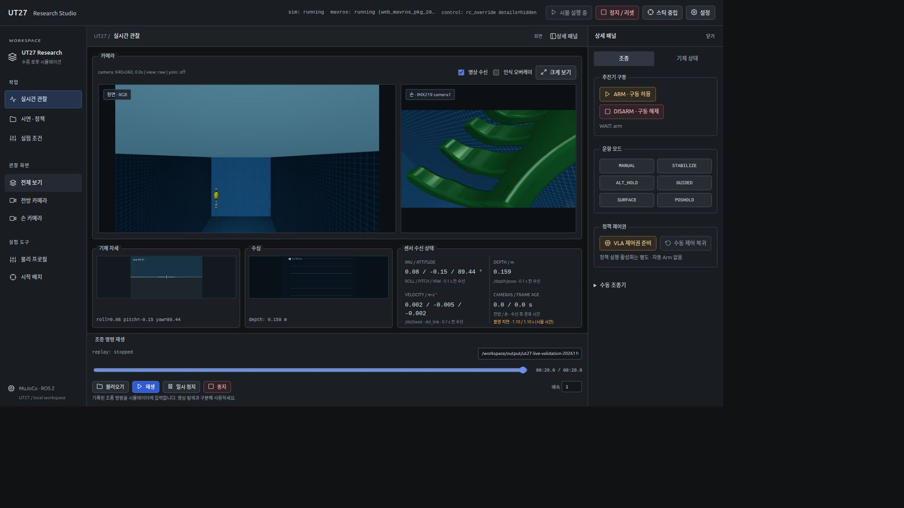

# UT27 Research Studio

**한국어** · [English](README.en.md)

MuJoCo 연구 수조에서 수중 로봇을 조종하고 VLA 시연을 수집하는 시뮬레이터입니다. 전방·손 카메라, 자세, 수심, DVL 속도를 한 화면에서 확인할 수 있습니다.



## 실행

[Docker 환경 설치](docker/ubuntu-dev/README.md) 후 이 브랜치의 저장소 루트에서 실행합니다.

```bash
bash tools/start_research_gui.sh
```

[연구 GUI](http://127.0.0.1:18879/)에서 **시뮬 시작 → STABILIZE → ARM → 수동 입력 켜기** 순서로 조종합니다. 종료할 때는 **조종 입력 해제 → DISARM**을 누릅니다.

## 검증 상태 · 2026-11-03

- **조종·센서** — 네 축 조종, 입력 중단 시 자동 해제, 두 카메라와 IMU·수심·DVL 수신을 확인했습니다.
- **시연 녹화** — 점검 PC의 CPU 렌더링에서 새 영상은 카메라당 약 1 FPS였습니다. 촬영 지연이 0.25초를 넘어 수집기가 녹화를 차단했습니다.
- **추가 검증** — 해당 환경에서 GUIDED·POSHOLD 전환과 YOLO 실행이 실패했습니다. GPU 정책 추론은 미검증입니다.

[UT27 논문·그림](docs/papers/ut27_2027/) · [시연 수집](rospkg/src/auv_vla_data_collector/README.md) · [VLA 모델 실행](tools/vla_gui/README.md) · [학습 결과](docs/UUV_UPDATE_20260922.md)
