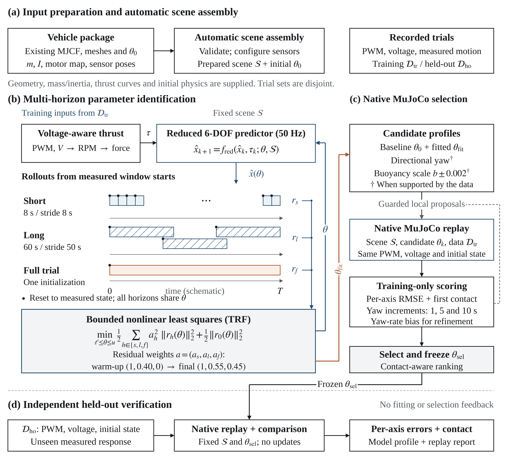

# 실측 로그로 MuJoCo 기체 자동 보정

**① 기체와 로그 준비 → ② 웹 GUI에서 계수 추정과 후보 선택 → ③ 별도 주행으로 검증**

기존 MuJoCo 기체 모델과 장착 정보를 입력하면, 보정용 주행의 모터 PWM·전압과 실제 운동을 이용해 감쇠·부력 등 물리 계수를 추정합니다. MuJoCo 재생으로 후보를 선택한 뒤, 별도로 기록한 주행에서 같은 프로필을 검증합니다.

[입력 규격과 보정 알고리즘](REAL2SIM_AUTOMATION.md) · [BlueROV2 비교 그래프](../paper/README.md)



*그림의 시간 막대는 보정에 쓰는 시간창의 배치를 보여주는 도식입니다.*

## 1. 입력 폴더 준비 — 그림 (a)

기체 모델과 보정·검증용 로그를 아래처럼 한 폴더에 모읍니다. 파일 경로는 `vehicle.json`이 있는 폴더를 기준으로 적습니다. 자동 장면 구성은 제공한 MJCF·메시·질량·관성을 바탕으로 입력을 검증하고 센서 장착 설정을 반영합니다.

```text
my_rov/
├── vehicle.json
├── model/
│   ├── scene.xml
│   ├── includes/                 # MJCF가 참조하는 XML
│   └── meshes/                   # MJCF가 참조하는 메시
├── config/
│   ├── profiles.json
│   └── thruster_performance.json
└── trials/
    ├── calibration_run/          # train
    │   ├── metadata.json
    │   ├── pwm.csv
    │   ├── real.csv
    │   └── voltage.csv
    └── validation_route/         # holdout
        ├── metadata.json
        ├── pwm.csv
        ├── real.csv
        └── voltage.csv
```

| 기체 파일 | 넣을 정보 |
| --- | --- |
| `vehicle.json` | 장면 및 설정 파일 경로, PWM 채널에 맞춘 추진기 순서와 부호, 센서 장착 자세, 보정·검증 주행 이름 |
| `model/scene.xml` | 설치 상태의 질량·관성·CoM, 추진기 사이트와 힘 방향, 수조·충돌 형상. 참조하는 XML과 메시도 `model/`에 포함 |
| `config/profiles.json` | 초기 감쇠·부력 등 물리 계수. [BlueROV2 프로필 예시](../../uuv_mujoco/current/config/sim_profiles_bluerov2.json) |
| `config/thruster_performance.json` | 장착한 추진기의 전압별 PWM·RPM·추력 곡선. [T200 데이터 예시](../../uuv_mujoco/current/config/thruster_performance.json) |

<details>
<summary><b>vehicle.json 예시와 센서 설정</b></summary>

아래는 추진기 2개에 대한 형식 예시입니다. 실제 기체의 모든 추진기를 `pwm1`, `pwm2`, … 순서대로 적으세요.

```json
{
  "version": 1,
  "name": "my_rov",
  "scene": "model/scene.xml",
  "profile_file": "config/profiles.json",
  "base_profile": "nominal",
  "thruster_perf_file": "config/thruster_performance.json",
  "thrusters": [
    {"name": "yaw_rf", "kind": "horizontal", "pwm_sign": -1, "forward_sign": 1},
    {"name": "ver_rf", "kind": "vertical", "pwm_sign": 1, "forward_sign": 1}
  ],
  "sensors": {
    "imu": {"pos_m": [0.05, 0, 0.08], "quat_wxyz": [1, 0, 0, 0]},
    "pressure": {"pos_m": [-0.15, 0, 0.09], "quat_wxyz": [1, 0, 0, 0]}
  },
  "train": ["calibration_run"],
  "holdout": ["validation_route"]
}
```

- MJCF에는 월드의 직접 자식인 `base_link`와 `world_joint` freejoint를 둡니다. 추진기는 `thr_<name>` 사이트에 연결합니다. 수면은 월드 `z=0`입니다.
- `pwm_sign`은 ESC 펄스와 모터 방향 사이의 부호, `forward_sign`은 모터 방향과 추력표의 정방향 사이의 부호입니다. 각각 `+1` 또는 `-1`을 씁니다.
- `imu`, `pressure`, `dvl`, `camera_left`, `camera_right` 중 설치한 센서만 선언합니다. 장착 위치와 정규화한 `quat_wxyz`는 `base_link`의 FLU(전방·좌측·상방) 기준입니다. 카메라의 수직 시야각은 `fovy_deg`로 지정합니다. [센서별 좌표 규칙](REAL2SIM_AUTOMATION.md#센서별-설정)

</details>

### 주행마다 필요한 파일 4개

| 주행 파일 | 형식 |
| --- | --- |
| `pwm.csv` | `t_s,pwm1,pwm2,...` · 최종 ESC 모터 출력 **RC_OUT** [µs], 중립 1500, 범위 1100–1900 |
| `real.csv` | `t_s`, 기체 원점 FRD 선속도 [m/s]·각속도 [rad/s], 수심 [m, 아래가 양수], NED 기준 자세 [deg] |
| `voltage.csv` | `sim_time,voltage_v` · `real.csv` 첫 표본부터 0초로 시작하는 전압 [V] |
| `metadata.json` | 예시 `{"initial_depth_m": 2.0, "initial_depth_reference": "base_link"}`. 압력 센서 기준이면 `"pressure"` 사용 |

<details>
<summary><b>CSV 헤더 복사하기</b></summary>

**pwm.csv**

```csv
t_s,pwm1,pwm2
0.000,1500,1500
0.025,1500,1500
0.050,1600,1500
```

**real.csv**

```csv
t_s,surge_mps,sway_mps,heave_mps,roll_rate_radps,pitch_rate_radps,yaw_rate_radps,depth_m,roll_deg,pitch_deg,yaw_deg
0.000,0,0,0,0,0,0,2.0,0,0,90.0
0.020,0.012,0,0,0,0,0.015,2.0,0,0,90.017
```

**voltage.csv**

```csv
sim_time,voltage_v
0.000,15.9
0.100,15.8
0.200,15.7
```

위 행은 형식 예시입니다. 실제 전압 로그는 실측 구간 전체를 덮어야 합니다. [검증 조건과 전압 간격](REAL2SIM_AUTOMATION.md#기록-예시와-검증-조건)

</details>

> **입력 점검** · `pwm.csv`와 `real.csv`는 같은 시계의 원본 시각을 사용하세요. `real.csv`의 첫 행은 모든 값이 유효해야 하고 이후 결측은 `nan`으로 둡니다. ROS 2 bag은 먼저 위 CSV로 변환합니다. 보정용 `train`과 검증용 `holdout`은 각각 따로 기록하세요. 실행 최소 길이는 보정 주행 3.1초, 검증 주행 1초이며 축마다 유효 대응 표본이 10개 이상 필요합니다.

## 2. 웹 GUI에서 보정 — 그림 (b), (c)

[웹 GUI를 시작](../../README.md#빠른-시작)하고 [보정용 Python 환경](REAL2SIM_AUTOMATION.md#실행)을 준비합니다.

1. 웹 GUI 왼쪽 **Vehicle Setup & Calibration**을 엽니다.
2. **Vehicle data folder**에 저장소 기준 입력 경로를 입력합니다. 예를 들어 `outputs/my_rov`입니다.
3. **Output folder name**에 새 이름을 넣고 **Build & calibrate**를 누릅니다. 기본 설정에서는 `outputs/<이름>/`에 저장합니다.

버튼을 누르면 두 단계가 이어서 실행됩니다.

- **(b) 계수 추정.** 실측 PWM과 전압을 추진기 RPM과 추력으로 변환해 50 Hz 경량 6자유도 모델에 넣습니다. 8초·60초 창은 각 창의 시작 시점 실측 상태로 초기화하고, 전체 주행은 처음에 한 번만 초기화합니다. 세 시간 범위의 예측 오차를 모아 한 세트의 물리 계수를 추정합니다.
- **(c) 후보 선택.** 초기 프로필과 보정 후보를 같은 `train` 주행의 PWM·전압·초기 상태로 MuJoCo에서 재생합니다. 접촉이 발생한 주행이 적은 후보를 우선하고, 정규화한 축별 오차와 짧은 구간의 yaw 변화 오차로 비교합니다. 선택 결과는 `fit.json`에 기록합니다.

<details>
<summary><b>터미널에서 실행하기</b></summary>

[Python 환경 준비](REAL2SIM_AUTOMATION.md#실행) 후 저장소 루트에서 실행합니다.

```bash
python uuv_mujoco/current/tools/real2sim_auto.py run outputs/my_rov \
  --output outputs/my-rov-fit --headless --jobs 4 --max-evaluations 35
```

</details>

## 3. 별도 주행으로 검증 — 그림 (d)

후보 선택이 끝나면 계수를 고정하고, 보정과 후보 선택에 사용하지 않은 `holdout` 주행을 MuJoCo에서 재생합니다. 실측 대비 축별 RMSE와 첫 접촉 시각을 함께 확인하세요.

완료 후 상단 **Vehicle**에서 생성된 기체를 선택합니다. **Recorded trial**에서 검증 주행을 고른 뒤, **Physics model**에서 비교할 프로필을 선택하고 **Open MuJoCo replay**를 누릅니다.

| 결과 파일 | 확인할 내용 |
| --- | --- |
| `model/`, `sensor_config.json`, `profiles.json` | 센서가 설치된 장면, 센서 구성, 보정된 물리 프로필 |
| `rmse.csv`, `replays/<trial>/aligned.csv` | 축별 오차와 공통 10 Hz 실측·재생 궤적 |
| `fit.json`, `report.json` | 추정 범위, 후보 선택 기록, 접촉 여부 및 검토 상태 |

일반 보정 결과는 `candidate`로 저장됩니다. 특정 보정 주행의 누적 yaw를 재현하려면 `yaw_target_trial`을 지정하세요. 이 경우 별도 `yaw_target` 프로필을 생성합니다. 각 프로필의 다른 주행에 대한 성능은 `holdout` 결과에서 비교할 수 있습니다.

### BlueROV2에서 재현

DFKI 수조의 무작위 주행에 각각 보정한 두 모델을 같은 2,036개 yaw 표본으로 비교했습니다. 누적 yaw RMSE는 기존 yaw 보정 **28.91°**, 자동 yaw 보정 **29.47°**입니다. 별도 검증 주행 4개의 평균은 기존 yaw 보정 **407.68°**, 주행 전용 자동 yaw 보정 **436.71°**, 일반 자동 보정 **310.38°**입니다. [6축 비교 그래프](../paper/auto-calibration-comparison.png) · [주행별 RMSE CSV](../paper/data/auto-calibration-comparison-rmse.csv) · [공개 로그 변환 및 재현 명령](REAL2SIM_AUTOMATION.md#bluerov2-재현)
